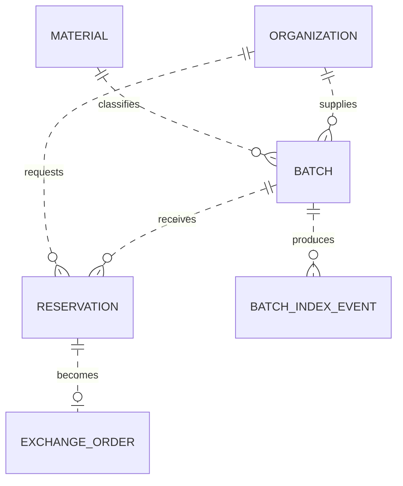

# Industrial Byproduct Exchange data model and interfaces

**Review draft · Task 01**

MySQL owns inventory, reservations, orders, and traceability. PostgreSQL holds a derived search projection. The Node.js worker copies committed changes from MySQL to PostgreSQL. A user discovers a batch through search, then opens its MySQL-backed details before reserving it.

## MySQL model



| Table | Columns and constraints |
| --- | --- |
| `organizations` | `id` PK, `name`. An organization can supply and receive batches. |
| `materials` | `id` PK, `name`, `category`, `unit`. Seed a shared catalog with unique `(category, name)` and one canonical unit per material, such as `kg` or `L`. |
| `batches` | `id` PK, `supplier_org_id` FK, `material_id` FK, `batch_code`, `description`, `location`, `total_quantity`, `status`, `revision`, `created_at`, `updated_at`. Unique `(supplier_org_id, batch_code)`. Status is `OPEN` or `CLOSED`. Revision starts at 1. |
| `reservations` | `id` PK, `batch_id` FK, `recipient_org_id` FK, `request_key`, `quantity`, `status`, `created_at`, `updated_at`. Unique `(recipient_org_id, request_key)`. Index `(batch_id, status)` for availability and trace queries. |
| `exchange_orders` | `id` PK, `reservation_id` unique FK, `placed_at`. Batch, recipient, and quantity come from the reservation. |
| `batch_index_events` | `id` PK, `batch_id` FK, `batch_revision`, `payload` JSON, `created_at`, `next_attempt_at`, `attempts`, nullable `processed_at`. Unique `(batch_id, batch_revision)`. Index `(processed_at, next_attempt_at, id)` for polling. |

Use positive signed `BIGINT` IDs and revisions so both databases share the same range. Serialize them as decimal strings at JSON boundaries. Store quantities as `DECIMAL(14,3)` and transmit them as strings with three fractional digits, such as `"120.000"`. Require positive totals and reservation quantities. Store timestamps in UTC and return ISO 8601 UTC strings.

The material catalog supplies the unit, the batch supplies the source, and the reservation supplies the recipient and ordered quantity. Use restrictive foreign keys and retain batch and exchange records for traceability. Batch code, supplier, material, recipient, and reserved quantity are fixed once their respective records are created.

### Availability and state transitions

```text
availableQuantity = totalQuantity - SUM(quantity of ACTIVE or CONVERTED reservations)
```

| Action | Rules and effect |
| --- | --- |
| Publish | Create an `OPEN` batch owned by the acting organization. |
| Edit or close | Only the supplier can change description, location, or total. The total must cover existing held and ordered quantities. `OPEN → CLOSED` stops new reservations. Existing holds can still be cancelled or converted. |
| Reserve | A recipient other than the supplier can reserve an `OPEN` batch if the requested quantity fits. Create an `ACTIVE` reservation. |
| Cancel | The recipient changes `ACTIVE → CANCELLED`, releasing the quantity. Cancellation of an already cancelled reservation returns its current state. |
| Place order | The recipient changes `ACTIVE → CONVERTED` and creates the order in the same transaction. Availability stays the same because the hold becomes a completed exchange. Repeating the action returns the existing order. |

Run mutations in an InnoDB transaction at `READ COMMITTED`. On an existing batch, lock its row by ID with `SELECT ... FOR UPDATE` before reading availability or modifying reservations. If the route starts from a reservation ID, resolve its immutable batch ID first and recheck ownership and reservation state after locking the batch. All writers follow this lock order. The batch lock serializes quantity checks, including concurrent requests from different recipients. [MySQL locking reads](https://dev.mysql.com/doc/refman/8.4/en/innodb-locking-reads.html) · [Transaction isolation levels](https://dev.mysql.com/doc/refman/8.4/en/innodb-transaction-isolation-levels.html)

Example with a `100.000 kg` batch. Reserving `60.000 kg` leaves `40.000 kg`. Converting that hold leaves the same `40.000 kg`. A second recipient can reserve `40.000 kg` and cancel to restore it. Two simultaneous requests for `60.000 kg` against a fresh batch result in one success and one conflict.

## HTTP interfaces

Use JSON. The local demo resolves the acting organization from a server-side demo session. Catalog, batch detail, and search are readable by demo organizations. Writes enforce the supplier or recipient rules above. A supplier sees its batch's full trace. A recipient sees its own reservations and orders for that batch. The trace includes the supplier and the distinct recipient organizations visible to the caller.

| Endpoint | Request | Success |
| --- | --- | --- |
| `GET /api/materials` | Optional `category` | `200 { items: Material[] }` |
| `GET /api/batches` | Optional `materialId`, `afterId`, `limit`. Lists open batches in ascending ID order. | `200 { items: Batch[], nextAfterId: Id or null }` |
| `POST /api/batches` | `{ materialId, batchCode, description, location, totalQuantity }` | `201 Batch` |
| `GET /api/batches/{batchId}` | Batch ID from the catalog or search result | `200 Batch` from MySQL |
| `PATCH /api/batches/{batchId}` | One or more of `description`, `location`, `totalQuantity`, `status` | `200 Batch` |
| `POST /api/batches/{batchId}/reservations` | `{ quantity }` and a UUID in the `Idempotency-Key` header | `201 Reservation`, or `200` for an identical retry |
| `POST /api/reservations/{reservationId}/cancel` | Empty body | `200 Reservation` |
| `POST /api/reservations/{reservationId}/order` | Empty body | `201 Order`, or `200` for an existing order |
| `GET /api/batches/{batchId}/trace` | Batch ID | `200 Trace` |
| `GET /api/search` | Required `q`. Optional `materialId`, `category`, `minAvailableQuantity`, `limit`. Minimum quantity requires `materialId` to fix the unit. | `200 { items: SearchResult[] }` from PostgreSQL |

```ts
type Id = string;
type Quantity = string;
type Timestamp = string;

type Organization = { id: Id; name: string };
type Material = { id: Id; name: string; category: string; unit: string };

type BatchSnapshot = {
  batchId: Id;
  supplierOrgId: Id;
  material: Material;
  batchCode: string;
  description: string;
  location: string;
  status: "OPEN" | "CLOSED";
  availableQuantity: Quantity;
  revision: Id;
};

type Batch = BatchSnapshot & { totalQuantity: Quantity };
type SearchResult = BatchSnapshot & { score: number };

type Reservation = {
  reservationId: Id;
  batchId: Id;
  recipientOrgId: Id;
  quantity: Quantity;
  status: "ACTIVE" | "CANCELLED" | "CONVERTED";
  createdAt: Timestamp;
  updatedAt: Timestamp;
};

type Order = {
  orderId: Id;
  reservationId: Id;
  placedAt: Timestamp;
};

type Trace = {
  batch: Batch;
  source: Organization;
  recipients: Organization[];
  reservations: Reservation[];
  orders: Order[];
};
```

Use `{ error: { code, message } }` for failures. Return `400` for invalid input (including blank search text), `401` for a missing demo session, `403` for an organization outside the allowed scope, `404` for a missing record, `409` for conflicts such as insufficient quantity or an incompatible state, and `503` when semantic search is unavailable. Scope the reservation key to the recipient. A retry with the same key, batch, and quantity returns the existing reservation, even if its state has changed. Reusing that key for another batch or quantity returns `409`. The unique constraint protects simultaneous retries. Use a default list limit of 20 and a maximum of 50.

Discovery links to `/batches/{batchId}`. The detail view refreshes availability from MySQL. The reservation endpoint rechecks it under the lock even when search and detail have both returned a positive quantity.

## MySQL-to-PostgreSQL interface

On publish and any change to the indexed batch fields, increment the batch revision for an existing batch and append a full snapshot to the outbox in the same transaction. Reserve and cancel can change availability and therefore emit snapshots. Conversion preserves availability and leaves the projection revision unchanged. The seeded catalog's material name, category, and unit are stable for this iteration.

Example `batch_index_events.payload` with schema version 1.

```json
{
  "type": "batch.search.upsert",
  "schemaVersion": 1,
  "batch": {
    "batchId": "42",
    "supplierOrgId": "1",
    "material": {
      "id": "3",
      "name": "Fly ash",
      "category": "Mineral residues",
      "unit": "kg"
    },
    "batchCode": "FA-001",
    "description": "Dry fly ash suitable for cement blending.",
    "location": "Bengaluru",
    "status": "OPEN",
    "availableQuantity": "40.000",
    "revision": "2"
  }
}
```

The event row's `batch_id` and `batch_revision` match the payload. `schemaVersion` describes the message format, while `batch.revision` orders snapshots for a single batch.

1. The demo runs one worker. Poll committed events where `processed_at IS NULL` and `next_attempt_at` is due. Validate the schema version and embed the snapshot's searchable text.
2. Upsert the snapshot and embedding into PostgreSQL by `batch_id`. On conflict update only when the incoming revision exceeds the stored revision. This covers out-of-order delivery and equal-revision replay. [PostgreSQL 17 upsert](https://www.postgresql.org/docs/17/sql-insert.html)
3. Mark the event processed in MySQL after PostgreSQL commits, including when the revision check makes the event a no-op. If indexing fails, increment attempts, record the failure in worker logs, and schedule another attempt with backoff. A crash between the PostgreSQL commit and MySQL acknowledgement results in a safe replay.

The rebuild reads current batch snapshots and revisions from MySQL and regenerates the projection. For the course demo, pause writes and the worker during the rebuild, then resume both. Include closed rows so their revisions continue to guard against older events.

## PostgreSQL search projection

Use one `batch_search` row per MySQL batch ID. Map `BatchSnapshot` to typed columns using `bigint` for IDs and revision and `numeric(14,3)` for availability. Add `embedding vector(384)` and `indexed_at timestamptz`. Start with the batch ID primary key and B-tree indexes on `material_id` and `category` for eligible rows.

Use `Xenova/all-MiniLM-L6-v2` with Transformers.js in Node.js. Embed the material name, category, and trimmed batch description in that order, joined by newline characters. The worker and search API share a pinned model revision, inference precision, mean pooling, and normalization. Both produce 384-dimensional vectors. Rebuild the index when the model or input formatting changes. [ONNX model](https://huggingface.co/Xenova/all-MiniLM-L6-v2) · [Embedding model card](https://huggingface.co/sentence-transformers/all-MiniLM-L6-v2)

Apply the selected filters to rows where status is `OPEN` and availability is positive. Rank by exact cosine distance using `<=>`, breaking ties by batch ID. Return `1 - distance` as the similarity score. The search payload describes the indexed snapshot, which can lag behind MySQL. [pgvector querying and filtering](https://github.com/pgvector/pgvector#filtering)

## Review decisions

- Confirm the seeded material categories and units, and the scope of the local demo organization picker.
- Confirm one batch per reservation and one full conversion per reservation. Order placement represents completion for the course demo.
- Confirm the batch detail route, JSON contract, and the source and recipient visibility rules.
- Confirm the embedding model against a few representative material queries and agree on the shared runtime settings.
